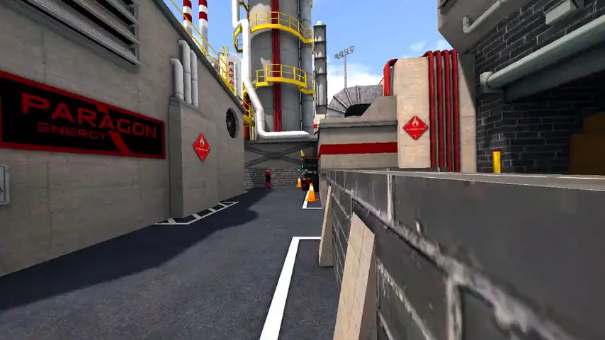

# ko client for deadshot.io

**tiny native client. no electron tax.**

[-FF4655?style=for-the-badge&logo=windows&logoColor=white)](https://download.ko-client.online/KO-Client.zip)

 

---

## why bother

- **actual game engine (godot 4.7)** — not another chrome / electron / webview wrapper eating half ur ram
- **potato mode & max fps** — `very low (max fps)` preset, low shader mode, 256px textures, turn off smoke/blood/weather fx, low-cpu audio, fps cap up to 480 or unlimited
- **custom res & aspect ratios** — `4:3 stretched`, `5:4 stretched`, `16:10 stretched`, `4:3 black bars`, or native
- **custom color presets** — built-in nvidia-style color grading (`valorant pro`, `high visibility`, `vivid`, or custom vibrance / brightness / contrast / gamma sliders)
- **footstep audio boost** — dedicated enemy footstep bus (up to 200% vol, never cut off by gunshots) + separate gunshot volume slider
- **deep crosshair & visibility tweaks** — separate custom crosshairs for hipfire, ar dot, and smg holo + enemy outline colors (`red`, `yellow`, `purple`) + left-hand viewmodel + separate hip/ads/scope sens
- **all gun skins unlocked** — every skin ready out of the box with 3d locker preview
- **plugins, mods & aim training** — custom hud, fx, sound booster, aim training modes, and more
- **zero ads** — no popups, no banners, no browser tab clutter
- **portable zip + auto update** — unzip once and forget about it

---

## vs other clients

| | **ko client** | haveli | omniverse | chrome |
| --- | --- | --- | --- | --- |
| **engine** | **native godot 4** | edge webview2 | electron (chromium) | browser tab |
| **low-end fps & ram** | **best fps, lowest ram** | edge overhead | heavy chromium tax | lag spikes |
| **stretched & color** | **4:3 / 5:4 / 16:10 + valorant pro** | nah | nah | nah |
| **footstep boost** | **dedicated enemy step bus** | nah | nah | nah |
| **gun skins** | **all unlocked** | manual swap | manual swap | locked |
| **plugins / mods** | **full plugins (hud, fx, aim training...)** | crosshair + skin swap | css + img swap | nah |
| **ads** | **none** | adblock | adblock | banners & video ads |
| **install** | **portable zip** | installer | installer | web |
| **open source** | **yep (mit)** | closed | yep | no |

---

## how to run (win 10 / 11 x64 — linux soon)

1. grab [`KO-Client.zip`](https://download.ko-client.online/KO-Client.zip) (or from [releases](https://github.com/fluxmeansflex/KO-DS-Client/releases/latest))
2. unzip anywhere
3. run `KO-Client.exe` — loader grabs the latest packs automatically and boots straight into the game

> [!TIP]
> u dont need to redownload the zip for game updates, the loader handles it on startup. linux build is coming soon.

---

## faq

does it actually boost fps on low end pcs?

yeah. running natively on windows instead of inside chrome cuts a ton of cpu/ram overhead, plus u get potato mode (`very low` preset, low shaders, fx toggles) and zero browser ads.

do i have to redownload every update?

nope. extract the portable zip once and `KO-Client.exe` updates automatically when u launch it.

can i use my normal deadshot.io account?

yes, just log in like normal. all gun skins are unlocked inside ko client too.

---

## links & license

- site: [ko-client.online](https://ko-client.online/) · [privacy](https://ko-client.online/privacy) · [tos](https://ko-client.online/terms-of-service)
- discord: [join server](https://discord.com/invite/nY2gbDjy)
- license: mit. see [`LICENSE`](../LICENSE).
